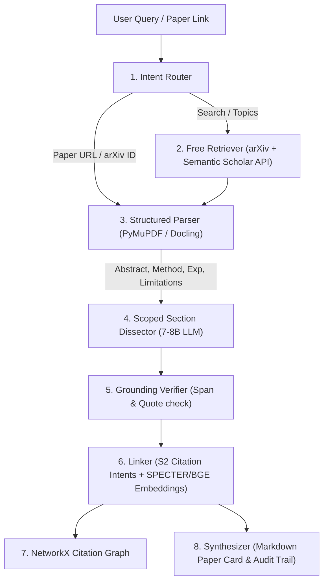

# Deep Academic Research Agent ($0 Budget / 100% Free Open Source)

A narrow-agent pipeline designed to dissect academic research papers, uncover critical weaknesses and unstated assumptions, extract practical downstream applications, and map citation and conceptual interconnections.

---

## 🏗️ Architectural Philosophy

> **"The model is not the bottleneck. Retrieval, parsing, and the citation graph decide the quality. A 7-8B model with great structure beats a big model with raw PDFs dumped in."**

Rather than treating the research agent as a monolithic black-box prompt, the system separates responsibilities into specialized modules:



---

## 🔑 Key Pillars

1. **Free Academic APIs (No Hallucinated Citations)**:
   - Uses **arXiv API** and **Semantic Scholar Academic Graph API** (free tier).
   - Semantic Scholar supplies hard ground-truth citation contexts and intents (`methodology`, `background`, `result`).

2. **Scoped Per-Section Dissection**:
   - Never dumps entire 30-page PDFs into the LLM context window.
   - Slices the paper into Abstract, Method, Experiments, and Limitations, executing laser-focused prompts for each.

3. **Fixed Schema Paper Card**:
   - `core_claim`: Primary thesis with verbatim quote pointer.
   - `method_summary`: Exactly 3-line methodology breakdown.
   - `novelty_vs_prior_work`: Explicit delta compared to prior literature.
   - `assumptions_and_weaknesses`: Critical bottlenecks, failure modes, and restrictive assumptions.
   - `reproducibility`: Code availability and benchmarks.
   - `applications`: Practical real-world engineering implementations.

4. **Hard Citations + Dense Embeddings (No "Vibes")**:
   - Hard evidence: Direct citation graph from S2.
   - Soft evidence: Dense semantic cosine similarity via SPECTER2 / BGE (`sentence-transformers`).
   - LLM only labels the relationship (`extends`, `contradicts`, `alternative_to`, `uses_method`, `benchmarks_against`).

5. **Grounding & Verifier Pass**:
   - Every claim is tied to an exact section and verbatim quote.
   - The verifier validates whether the statement is truthfully supported by the quote.

6. **Aggressive Caching**:
   - Extracted paper cards and downloaded PDFs are cached in `.cache/`. A paper is never parsed twice.

---

## 🚀 Quickstart ($0 Setup)

### 1. Install Requirements
```bash
pip install -r requirements.txt
```

### 2. Start Local Open-Source LLM
Using [Ollama](https://ollama.com/) (Free, runs locally on CPU or GPU):
```bash
ollama pull qwen2.5:7b
ollama serve
```
*(You can also use `llama3.1:8b`, `mistral:7b`, or free endpoints like Groq/LM Studio by setting `OPENAI_COMPATIBLE_BASE_URL` in `.env`)*

### 3. Usage Examples

#### Dissect a specific research paper:
```bash
python cli.py dissect 1706.03762
```
or with a URL:
```bash
python cli.py dissect https://arxiv.org/abs/2305.18290
```

#### Search papers catering to a problem:
```bash
python cli.py search "speculative decoding for low latency inference"
```

#### Compare two approaches:
```bash
python cli.py compare "Direct Preference Optimization vs RLHF PPO"
```

#### Map literature interconnections of a subfield:
```bash
python cli.py map "State Space Models vs Transformers"
```

#### Natural language prompt:
```bash
python cli.py ask "What are the core weaknesses of LoRA fine-tuning and how do newer papers address them?"
```
